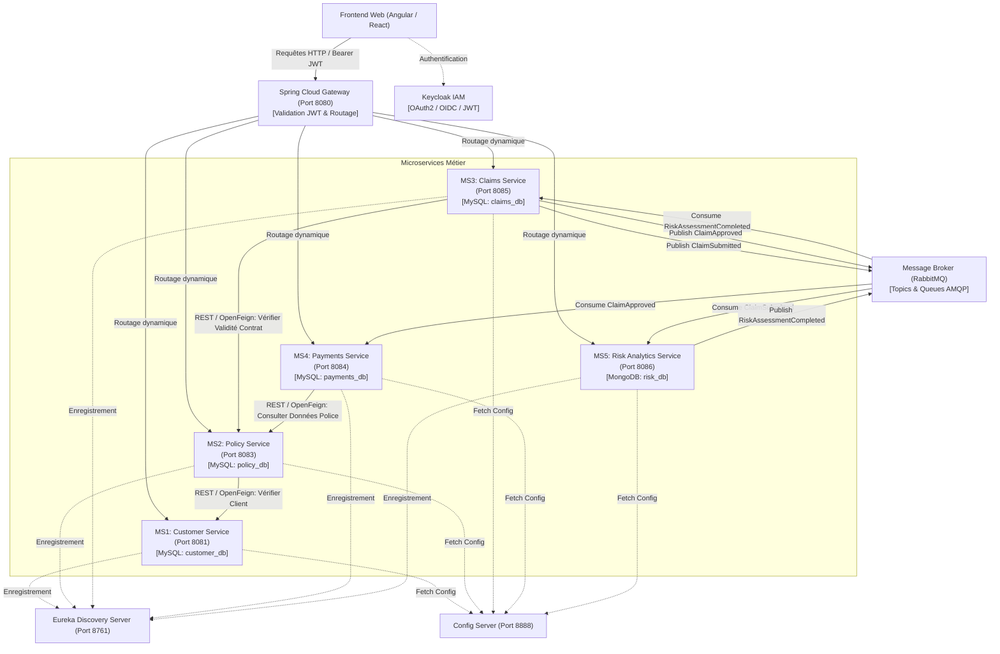
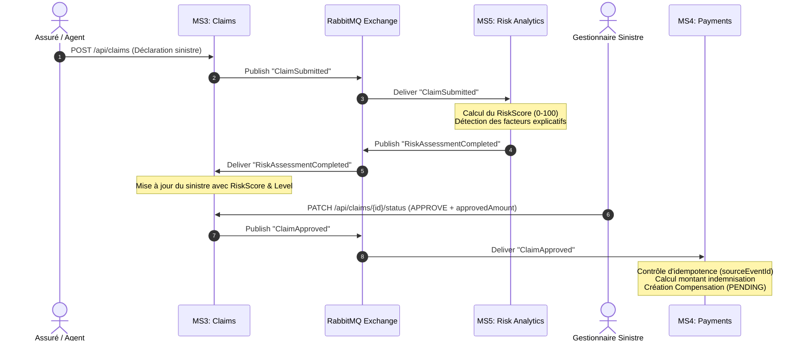

# InsurBridge — Plateforme Intelligente de Gestion d'Assurance

[](https://openjdk.org/)
[](https://spring.io/projects/spring-boot)
[](https://spring.io/projects/spring-cloud)
[](https://www.rabbitmq.com/)
[](https://www.mysql.com/)
[](https://www.mongodb.com/)
[](https://www.keycloak.org/)
[](https://www.docker.com/)

---

## 📌 À Propos du Projet

**InsurBridge** est une solution logicielle distribuée hautement disponible dédiée à une compagnie d’assurance moderne. Elle centralise et dématérialise l’ensemble du cycle de vie assurantiel : référentiel clients, gestion des polices d’assurance, déclaration et instruction des sinistres, paiements des cotisations et versement des indemnisations.

La plateforme intègre en son cœur un microservice avancé d’**analyse et scoring de risque (Risk Analytics)** alimenté par une architecture orientée événements (*Event-Driven Architecture*), fournissant aux gestionnaires une aide à la décision explicable et transparente sans automatisation arbitraire.

> **Cadre académique :** Mini-projet — *Architecture Web Distribuée (AWD)*  
> **Année universitaire :** 2026 – 2027  
> **Classe & Groupe :** 4Actuariat — Groupe 8  
> **Enseignante encadrante :** Mme Ons Ben Salah  

---

## 👥 Équipe de Développement — CodeUnity

Le projet est développé en équipe selon une stricte séparation des responsabilités par domaine métier (*Domain-Driven Design / Bounded Contexts*) :

| Membre | Microservice Attribué | Rôle & Tâches Individuelles | Responsabilités Transverses |
| :--- | :--- | :--- | :--- |
| **Ben Mahmoud Maram** | **MS1 — Customer Management** | Entité `Customer`, objet valeur `Address`, API CRUD clients, recherche multi-critères, désactivation logique, diagramme de classes MS1. | Frontend (Vues Clients & Contrats), coordination UI. |
| **Ben Aissa Aya** | **MS2 — Policy Management** | Entité `Policy`, objet valeur `InsuredItem`, validation de couverture `isValidAt()`, API polices, client OpenFeign vers MS1. | API Gateway (Spring Cloud Gateway) & Service Discovery (Eureka Server). |
| **Hmem Mohamed Ali** | **MS3 — Claims Management** | Entités `Claim` & `ClaimDocument`, cycle de vie des sinistres, publication de `ClaimSubmitted` et `ClaimApproved`, API sinistres. | Spring Cloud Config Server & Configuration RabbitMQ. |
| **Jnene Zeineb** | **MS4 — Payments Management** | Entités `Payment` & `Compensation`, gestion des primes et indemnisations, consommation idempotente de `ClaimApproved`. | Sécurisation Keycloak (OAuth2/JWT) & Docker Compose. |
| **Tous les membres** | **MS5 — Risk Analytics** *(Commun)* | Modèle NoSQL `RiskAssessment`, consommation de `ClaimSubmitted`, moteur de scoring transparent, publication de `RiskAssessmentCompleted`. | Conception globale, tests d’intégration, documentation & soutenance. |

---

## 🏛️ Architecture Globale du Système

InsurBridge repose sur une **architecture microservices distribuée** combinant communications synchrones (REST via OpenFeign) et asynchrones (Event-Driven via RabbitMQ) :



---

## 📦 Détail des Microservices

### 1. MS1 — Customer Management (`customer-service`)
- **Responsable :** Ben Mahmoud Maram
- **Port :** `8081` | **Base de données :** MySQL (`customer_db`)
- **Modèle métier :** Entité `Customer`, objet valeur `@Embeddable Address`, énumérations `CustomerStatus` (`ACTIVE`, `INACTIVE`), `ProfessionCategory`.
- **Règles clés :**
  - Pas de suppression physique : désactivation logique (`deactivate()`) pour préserver l'historique légal.
  - Unicité stricte sur `nationalId` (CIN / Passeport) et `email` (retourne `409 Conflict` en cas de doublon).
  - Aucune dépendance de schéma vers les autres microservices ; référence externe via `customerId`.

### 2. MS2 — Policy Management (`ms2-policy`)
- **Responsable :** Ben Aissa Aya
- **Port :** `8083` | **Base de données :** MySQL (`policy_db`)
- **Modèle métier :** Entité `Policy`, objet valeur `@Embeddable InsuredItem`, énumérations `PolicyType` (`AUTO`, `HABITATION`, `SANTE`, `VIE`), `PolicyStatus` (`DRAFT`, `ACTIVE`, `SUSPENDED`, `EXPIRED`, `CANCELLED`), `PaymentFrequency` (`MONTHLY`, `QUARTERLY`, `ANNUAL`).
- **Règles clés :**
  - Vérification de l'existence et du statut actif du client auprès de MS1 via **OpenFeign** avant la validation d'un contrat.
  - Détermination dynamique de validité via la méthode métier `isValidAt(LocalDate incidentDate)` (vérifie le statut et l'intervalle `[startDate, endDate]`).
  - Définition contractuelle de la franchise (`deductible`) et du plafond d'indemnisation (`coverageAmount`).

### 3. MS3 — Claims Management (`claims-center`)
- **Responsable :** Hmem Mohamed Ali
- **Port :** `8085` | **Base de données :** MySQL (`claims_db`)
- **Modèle métier :** Entités `Claim` et `ClaimDocument` (composition JPA), énumérations `ClaimStatus` (`PENDING`, `UNDER_REVIEW`, `APPROVED`, `REJECTED`), `IncidentType`.
- **Règles clés :**
  - Vérification synchrone auprès de MS2 de l'existence et de la validité du contrat à la date du sinistre (`/api/policies/{id}/validity?date=...`).
  - Déclenchement automatique de l'analyse : publication asynchrone de l'événement `ClaimSubmitted`.
  - Réception du score de risque via consommation de `RiskAssessmentCompleted` et mise à jour locale du sinistre (`riskScore`, `riskLevel`).
  - Décision finale tracée réservée au rôle `GESTIONNAIRE` : enregistrement de l'approbation (`approvedAmount`, `decidedBy`, `decisionDate`) et émission de l'événement `ClaimApproved`.

### 4. MS4 — Payments Management (`payments-service`)
- **Responsable :** Jnene Zeineb
- **Port :** `8084` | **Base de données :** MySQL (`payments_db`)
- **Modèle métier :** Entités distinctes `Payment` (primes payées par l'assuré) et `Compensation` (indemnisations versées par l'assureur), énumérations `PaymentStatus` (`PENDING`, `PAID`, `OVERDUE`, `FAILED`, `CANCELLED`), `CompensationStatus` (`PENDING`, `PROCESSING`, `PAID`, `FAILED`).
- **Règles clés :**
  - Séparation stricte des deux flux financiers (primes vs indemnisations).
  - Consommation asynchrone de `ClaimApproved` : calcul autonome de l'indemnisation effective :
    $$\text{Montant versé} = \min(\text{approvedAmount} - \text{deductible}, \text{coverageAmount})$$
  - Idempotence garantie grâce à la contrainte d'unicité sur `sourceEventId` (évite les doubles paiements en cas de rejeu de message).

### 5. MS5 — Risk Analytics (`risk-analytics-center` — Microservice Commun)
- **Responsables :** Les 4 étudiants (Projet transverse)
- **Port :** `8086` | **Base de données :** MongoDB (`risk_db`, collection `risk_assessments`)
- **Rôle avancé & Architecture :**
  - Microservice **100% orienté événements** (aucun appel REST direct entrant des autres services).
  - Stockage NoSQL flexible permettant l'évolution dynamique de la structure des facteurs de risque (`RiskFactor` imbriqués).
  - Moteur de scoring explicable basé sur des règles auditables :
    - Évaluation du montant déclaré (`estimatedAmount`).
    - Délai de déclaration par rapport à la date de l'incident.
    - Présence et cohérence des pièces justificatives.
    - Ancienneté du contrat et antécédents.
  - Classification indicative :
    - `0` à `39` : 🟢 **LOW**
    - `40` à `69` : 🟡 **MEDIUM**
    - `70` à `100` : 🔴 **HIGH**
  - Publication immédiate de `RiskAssessmentCompleted` vers RabbitMQ pour enrichir le dossier dans MS3.

---

## 🔄 Matrice des Communications Interservices

### 1. Appels Synchrones (REST / Spring Cloud OpenFeign)

| Émetteur | Destinataire | Endpoint Consommé | Objectif Métier | Protection & Résilience |
| :--- | :--- | :--- | :--- | :--- |
| **MS2 (Policy)** | **MS1 (Customer)** | `GET /api/customers/{id}` | Vérifier l'existence et l'état actif du client avant création du contrat | Resilience4j Circuit Breaker + Timeout |
| **MS3 (Claims)** | **MS2 (Policy)** | `GET /api/policies/{id}/validity?date={d}` | Vérifier que le contrat couvre la date de survenance du sinistre | Resilience4j Circuit Breaker + Fallback contrôlé |
| **MS4 (Payments)** | **MS2 (Policy)** | `GET /api/policies/{id}` | Consulter la prime et la périodicité pour valider une échéance | Resilience4j Circuit Breaker |

### 2. Flux Asynchrones (RabbitMQ Event-Driven)



---

## 📑 Contrats d'Événements RabbitMQ

### 1. `ClaimSubmitted` (MS3 $\rightarrow$ MS5)
```json
{
  "eventId": "evt-claim-1001-submitted",
  "occurredAt": "2026-11-09T10:30:00Z",
  "claimId": 1001,
  "customerId": 25,
  "policyId": 310,
  "declarationDate": "2026-11-09T10:30:00Z",
  "incidentDate": "2026-11-08",
  "incidentCity": "Tunis",
  "description": "Accident de circulation avec tiers identifié",
  "estimatedAmount": 2500.00,
  "currency": "TND"
}
```

### 2. `RiskAssessmentCompleted` (MS5 $\rightarrow$ MS3)
```json
{
  "eventId": "evt-risk-1001-completed",
  "occurredAt": "2026-11-09T10:31:00Z",
  "claimId": 1001,
  "assessmentId": "risk-7f31a",
  "riskScore": 42,
  "riskLevel": "MEDIUM",
  "analysisDate": "2026-11-09T10:31:00Z",
  "factorsSummary": [
    "DOCUMENTS_PRESENT",
    "AMOUNT_MEDIUM",
    "POLICY_OLDER_THAN_6_MONTHS"
  ]
}
```

### 3. `ClaimApproved` (MS3 $\rightarrow$ MS4)
```json
{
  "eventId": "evt-claim-1001-approved",
  "occurredAt": "2026-11-09T14:00:00Z",
  "claimId": 1001,
  "customerId": 25,
  "policyId": 310,
  "approvedAmount": 2200.00,
  "deductible": 300.00,
  "coverageAmount": 20000.00,
  "currency": "TND",
  "approvalDate": "2026-11-09T14:00:00Z"
}
```

---

## 🌐 Catalogue des Endpoints API REST

### MS1 — Clients (`/api/customers`)
| Méthode | Endpoint | Description | Rôles Requis |
| :--- | :--- | :--- | :--- |
| `POST` | `/api/customers` | Créer une fiche client | `AGENT`, `ADMIN` |
| `GET` | `/api/customers` | Lister et rechercher des clients | `AGENT`, `ADMIN` |
| `GET` | `/api/customers/{id}` | Consulter un profil client par identifiant | `CLIENT` *(propriétaire)*, `AGENT`, `ADMIN` |
| `PUT` | `/api/customers/{id}` | Mettre à jour les informations de contact | `AGENT`, `ADMIN` |
| `PATCH` | `/api/customers/{id}/status` | Activer ou désactiver logiquement un client | `ADMIN` |

### MS2 — Contrats d'Assurance (`/api/policies`)
| Méthode | Endpoint | Description | Rôles Requis |
| :--- | :--- | :--- | :--- |
| `POST` | `/api/policies` | Souscrire une nouvelle police après vérification client | `AGENT`, `ADMIN` |
| `GET` | `/api/policies` | Lister et filtrer les contrats | `AGENT`, `ADMIN` |
| `GET` | `/api/policies/{id}` | Détails d'un contrat spécifique | `CLIENT` *(propriétaire)*, `AGENT`, `ADMIN` |
| `GET` | `/api/policies/customer/{customerId}` | Obtenir toutes les polices d'un client | `CLIENT` *(propriétaire)*, `AGENT`, `ADMIN` |
| `GET` | `/api/policies/{id}/validity?date=YYYY-MM-DD` | Vérifier l'éligibilité et validité temporelle | Interservice (`MS3`), `AGENT` |
| `PATCH` | `/api/policies/{id}/status` | Suspendre, réactiver ou résilier un contrat | `AGENT`, `ADMIN` |

### MS3 — Sinistres (`/api/claims`)
| Méthode | Endpoint | Description | Rôles Requis |
| :--- | :--- | :--- | :--- |
| `POST` | `/api/claims` | Déclarer un sinistre (vérifie la validité contrat) | `CLIENT`, `AGENT` |
| `GET` | `/api/claims` | Liste des sinistres | `GESTIONNAIRE`, `ADMIN` |
| `GET` | `/api/claims/{id}` | Consulter le dossier complet avec pièces et score | `CLIENT` *(propriétaire)*, `GESTIONNAIRE` |
| `GET` | `/api/claims/customer/{customerId}` | Historique des sinistres d'un client | `CLIENT` *(propriétaire)*, `AGENT`, `GESTIONNAIRE` |
| `POST` | `/api/claims/{id}/documents` | Téléverser / associer un justificatif | `CLIENT`, `GESTIONNAIRE` |
| `PATCH` | `/api/claims/{id}/status` | Passer en revue, approuver ou rejeter le sinistre | `GESTIONNAIRE` |

### MS4 — Paiements & Indemnisations (`/api/payments` & `/api/compensations`)
| Méthode | Endpoint | Description | Rôles Requis |
| :--- | :--- | :--- | :--- |
| `POST` | `/api/payments` | Enregistrer un paiement de cotisation | `CLIENT`, `AGENT` |
| `GET` | `/api/payments` | Consulter la liste des paiements | `AGENT`, `ADMIN` |
| `GET` | `/api/payments/customer/{customerId}` | Consulter les paiements d'un assuré | `CLIENT` *(propriétaire)*, `AGENT` |
| `GET` | `/api/compensations` | Lister les ordres d'indemnisation | `GESTIONNAIRE`, `ADMIN` |
| `GET` | `/api/compensations/{id}` | Détail d'une indemnisation | `CLIENT` *(propriétaire)*, `GESTIONNAIRE` |
| `PATCH` | `/api/compensations/{id}/status` | Valider le versement effectif de l'indemnité | `GESTIONNAIRE`, `ADMIN` |

### MS5 — Risk Analytics (`/api/risk-assessments`)
| Méthode | Endpoint | Description | Rôles Requis |
| :--- | :--- | :--- | :--- |
| `GET` | `/api/risk-assessments/claim/{claimId}` | Obtenir le rapport d'analyse de risque détaillé | `GESTIONNAIRE`, `ADMIN` |
| `GET` | `/api/risk-assessments/high-risk` | Lister les dossiers classés à risque élevé | `GESTIONNAIRE` |
| `POST` | `/api/risk-assessments` | Déclencher manuellement un re-scoring | `GESTIONNAIRE`, `ADMIN` |

---

## 🔐 Sécurité & Gestion des Rôles (Keycloak IAM)

La sécurité globale repose sur le protocole **OAuth2 / OpenID Connect (OIDC)** via **Keycloak** :
1. Le client web s'authentifie sur Keycloak et reçoit un jeton **JWT** cryptographiquement signé.
2. Le jeton est transmis dans le header `Authorization: Bearer <TOKEN>` à travers la **Spring Cloud Gateway**.
3. La passerelle vérifie la validité du token, filtre les accès réseau et transmet les métadonnées d'identité aux microservices.
4. Chaque microservice applique un contrôle d'autorisation RBAC (*Role-Based Access Control*) :
   - `CLIENT` : Accès restreint à ses propres contrats, déclarations, paiements et suivis.
   - `AGENT` : Gestion du portefeuille clients et contrats d'assurance.
   - `GESTIONNAIRE` : Instruction des sinistres, analyse de risque, validation des montants et indemnités.
   - `ADMIN` : Supervision technique, audits et administration de la plateforme.

> **Principe de protection des ressources :** La vérification du rôle est systématiquement complétée par la vérification de la **propriété des données** (un client ne peut accéder qu'aux identifiants lui appartenant).

---

## 🛡️ Résilience & Robustesse Opérationnelle

- **Circuit Breaker (Resilience4j) :** Les appels synchrones interservices (ex: MS3 $\rightarrow$ MS2) sont protégés contre les pannes en cascade grâce à des disjoncteurs logiciels, des seuils de basculement et des fallbacks explicites.
- **Idempotence des Consommateurs AMQP :** Tous les gestionnaires de messages RabbitMQ enregistrent et vérifient les `eventId` reçus afin d'empêcher les traitements en doublon.
- **Gestion des Échecs Asynchrones :** Mise en œuvre de mécanismes de rejeu (*retries*) avec délai exponentiel et routage vers une **Dead Letter Queue (DLQ)** en cas d'erreur irréversible.

---

## 📂 Structure du Répertoire

```text
jobBoard-4actuariat-g8/
├── Backend/
│   ├── customer-service/          # MS1: Gestion des clients (Maram)
│   ├── ms2-policy/                # MS2: Gestion des contrats & polices (Aya)
│   ├── claims-center/             # MS3: Gestion des déclarations & sinistres (Mohamed Ali)
│   ├── payments-service/          # MS4: Primes & indemnisations financières (Zeineb)
│   ├── risk-analytics-center/     # MS5: Moteur de risque NoSQL / AMQP (Projet Commun)
│   ├── api-gateway/               # Spring Cloud Gateway (Port 8080)
│   ├── eureka-server/             # Eureka Service Registry (Port 8761)
│   └── config-server/             # Spring Cloud Config Server (Port 8888)
├── Frontend/                      # Application cliente Web (Interface utilisateur)
├── Documentation/
│   ├── Diagrams/                  # Diagrammes d'architecture, classes et flux
│   │   ├── MS1.png                # Diagramme de classes MS1 Customer
│   │   ├── MS2.png                # Diagramme de classes MS2 Policy
│   │   ├── MS3.png                # Diagramme de classes MS3 Claims
│   │   └── MS4.png                # Diagramme de classes MS4 Payments
│   └── Presentation/
│       └── InsurBridge_Presentation.pptx # Support de soutenance (Séance 4)
├── InsurBridge_Dossier_Conception.docx   # Dossier de conception détaillé complet
├── docker-compose.yml             # Orchestration locale multi-conteneurs
└── README.md                      # Documentation principale du projet
```

---

## 🚀 Guide de Démarrage Rapide

### Prérequis
- **JDK :** Java 17 ou 21 LTS
- **Build tool :** Maven 3.8+
- **Conteneurs :** Docker & Docker Compose
- **Bases de données locales (si hors Docker) :**
  - MySQL Server (Port `3306` ou `3307`)
  - MongoDB Server (Port `27017`)
  - RabbitMQ Server avec plugin Management (Ports `5672` & `15672`)

### 1. Démarrage de l'Infrastructure avec Docker Compose
Pour lancer l'ensemble des dépendances (MySQL, MongoDB, RabbitMQ, Keycloak, Eureka) :
```bash
docker compose up -d
```

### 2. Démarrage des Microservices Backend (Maven)
Dans chaque sous-répertoire de `Backend/` (ou via vos profils d'exécution IDE) :

```bash
# Exemple pour le service de polices
cd Backend/ms2-policy
./mvnw spring-boot:run

# Exemple pour le service de sinistres
cd ../claims-center
./mvnw spring-boot:run

# Exemple pour le service de paiements
cd ../payments-service
./mvnw spring-boot:run

# Exemple pour le service d'analyse de risque
cd ../risk-analytics-center
./mvnw spring-boot:run
```

### 3. Consoles et Tableaux de Bord

| Service | URL d'Accès | Identifiants par Défaut |
| :--- | :--- | :--- |
| **Eureka Discovery Dashboard** | `http://localhost:8761` | *Accès libre* |
| **RabbitMQ Management** | `http://localhost:15672` | `guest` / `guest` |
| **Keycloak Admin Console** | `http://localhost:8080/admin` | `admin` / `admin` |
| **API Gateway** | `http://localhost:8080` | *Point d'entrée unifié* |

---

## 🌿 Règles de Contribution & Workflow Git

- **Branches principales :**
  - `main` : Version stable et testée, prête pour la livraison / validation.
  - `develop` : Branche d'intégration active du groupe.
  - `feature/<service>-<nom>` : Une branche dédiée par fonctionnalité (ex: `feature/claims-rabbitmq`, `feature/ms2-policy`).
- **Revue de code :** Aucune modification directe sur `main`. Les fusions se font par **Pull Request** avec validation croisée d'un pair.
- **Convention de commits :** Norme [Conventional Commits](https://www.conventionalcommits.org/) :
  - `feat(...)`: Ajout d'une nouvelle fonctionnalité
  - `fix(...)`: Correction d'un bug
  - `docs(...)`: Mise à jour documentaire ou diagrammes
  - `chore(...)`: Configuration build, dépendances ou refactoring

